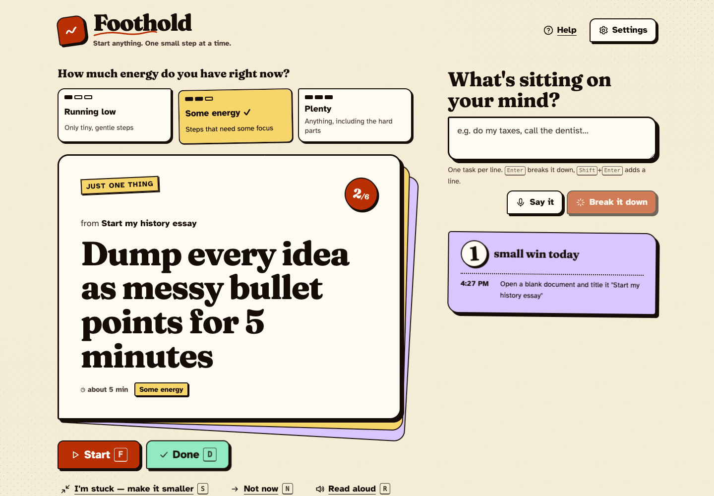

# Foothold

**Start anything. One small step at a time.**

Foothold is an accessible task starter for people who find *starting* the hardest part, including people with ADHD, executive dysfunction, depression, chronic fatigue, or anyone who is overwhelmed. You tell it what's on your mind. It breaks each task into tiny, concrete steps, asks how much energy you have, and then shows you **just one step** that fits.

**Live demo:** https://beingkumara.github.io/foothold/

**Launch video (20 s):** [docs/demo/foothold-launch.mp4](docs/demo/foothold-launch.mp4) · **Walkthrough (1 min):** [docs/demo/foothold-demo.webm](docs/demo/foothold-demo.webm)



## Why

To-do apps assume the hard part is *remembering*. For many people the hard part is *beginning*. A list of 30 tasks doesn't help someone who is frozen. It makes the freeze worse. Foothold makes three changes to the usual design:

| Typical to-do app | Foothold |
| --- | --- |
| Shows everything at once | Shows **one** step; the full list is hidden until you ask for it |
| Tasks are as big as you typed them | Every plan opens with a **≤ 2-minute "foothold" step** |
| Ignores how you feel | Steps are tagged by **energy**, so you only see steps that fit how you feel right now |
| "Overdue!" guilt | **"I'm stuck"** shrinks the step; **"Not now"** sets it aside, no penalty |
| Countdown timers | A focus timer that **counts up**, and nothing happens when the time is up |
| Streaks you can break | A **wins log** that counts every small step you finish |

## Features

- **Brain dump, typed or spoken.** One task per line. Voice input uses the Web Speech API where the browser supports it.
- **Offline breakdown engine.** Templates for writing, studying, email, cleaning, admin and forms, calls and appointments, shopping, code, exercise, cooking, and laundry, plus a general fallback. It needs no network and no account.
- **Optional AI breakdowns, free.** Add a free [Groq](https://console.groq.com/keys) key in Settings (no card needed) and an open model (Llama 3.3 70B, falling back to GPT-OSS 20B or Llama 3.1 8B if one is retired) writes custom steps. If the AI fails, Foothold falls back to the offline engine and tells you why.
- **Energy check-in** (Running low / Some energy / Plenty). The picker never leaves you stuck: if no step fits, it offers the gentlest one, flags it as a stretch, and says that resting is a valid choice.
- **Focus mode.** A full-screen view with a visual timer, an optional soft chime, and "I did it", "Pause", and "I'm stuck" buttons.
- **"I'm stuck"** replaces the current step with smaller, gentler sub-steps.
- **Read aloud** for any step, using the device voice.
- **Wins log** of every step you finish today.
- **Backup and restore** as JSON. No accounts and no tracking. Data stays in your browser.
- **Works offline** after the first visit: a service worker caches the whole app, so you can reload and plan with no network.
- **Test key** in Settings checks your Groq key with a single tiny request.

## How it compares

goblin.tools Magic ToDo, Tiimo, Amazing Marvin, and Lifestack each cover part of this space: AI breakdowns, visual planning, energy tags, or energy-aware scheduling. Foothold's contribution is the combination. It **chooses one step** for your current energy and hides the rest, shrinks it on demand ("I'm stuck"), needs **no account**, works **offline**, and has its accessibility tested in CI. See [docs/DEVPOST.md](docs/DEVPOST.md#how-it-compares) for the sourced comparison table.

## Accessibility (built in from the start)

- **Atkinson Hyperlegible** body font, designed by the Braille Institute for low-vision readers.
- **Reading-comfort spacing** that adds letter, word, and line spacing. The layout also holds up under the full WCAG 1.4.12 text-spacing overrides, which is tested automatically.
- **Text size** up to 150%, with no horizontal scrolling at 320px (WCAG 1.4.10 Reflow). This is tested automatically.
- **High-contrast mode** in both light and dark, plus light, dark, and system themes.
- **Reduced motion** follows the OS setting live and also has its own toggle. Card flings, the confetti burst, and the breathing blob are all switched off.
- **Every gesture has a button** (WCAG 2.5.7): fling right for Done or left for Not now, or use the buttons and shortcuts.
- **Screen readers:** every action is announced through ARIA live regions, and dialogs use native `<dialog>` for focus trapping, Escape to close, and focus returning to where you were.
- **Keyboard-first:** a skip link, visible focus rings, and focus that stays put when the step changes. Single-key shortcuts (F, D, S, N, R, 1–3, /, ?) never fire while you type, and **you can turn them off** (WCAG 2.1.4).
- **Never colour alone:** energy levels always have a text label and a bar-meter shape.
- **44px minimum target size** on all controls.
- **Automated checks:** axe-core finds zero WCAG 2.2 AA violations in the empty, planned, dark, and high-contrast states.

## Tech

- React 19, TypeScript (strict), Vite, and **Motion** for spring physics, gestures, and layout animation. 133 KB of JS gzipped, with fonts self-hosted.
- State is an immutable reducer, persisted to `localStorage` and validated with **zod** on load and import.
- **58 unit tests** (Vitest) with **96% coverage** of the logic, state, and hooks. Thin wrappers around browser speech and audio APIs are excluded from coverage and exercised manually.
- **17 Playwright E2E tests** (run on desktop and mobile), covering axe accessibility scans, offline reload, keyboard flows, swipe gestures, reduced motion, persistence, and reflow.
- CI on GitHub Actions runs the tests and deploys to GitHub Pages.

```
src/
├── lib/            breakdown engine, Groq client, storage + zod schemas, planner
├── state/          app reducer + next-step picker, settings schema
├── hooks/          store, settings, live-region announcer, speech, shortcuts, focus timer
├── components/     energy · capture · next-step · task-list · focus · settings · wins · ui
└── styles/         design tokens (light / dark / high-contrast / comfort) + globals
```

### How the next step is chosen

`pickNextStep` in `src/state/tasks.ts`:

1. Take the first unfinished step of each open task, so plans stay in order.
2. Drop steps you said "Not now" to. These come back when you change your energy level.
3. Sort tasks pinned to today first, then tasks already in progress (momentum), then the oldest.
4. Return the first step whose energy is at or below your current energy. If none fits, return the gentlest step and flag it as a `stretch`.

## Run it

```bash
npm install
npm run dev        # http://localhost:5173/foothold/
npm test           # unit tests
npm run coverage
npm run e2e        # Playwright + axe (uses installed Google Chrome)
npm run build
```

## Privacy

Foothold has no backend. Your plans live in your browser's local storage. If you add a Groq key, it is stored only in your browser, and the only data sent to `api.groq.com` is the task title you are planning.

## Licence

MIT
